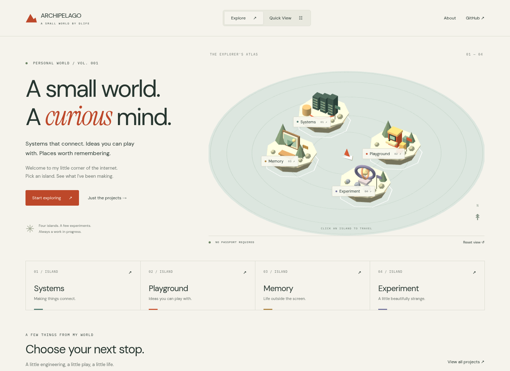

# ARCHIPELAGO

**A small world. A curious mind.** Portofolio interaktif DLife: dunia miniatur untuk menjelajahi karya, dengan jalur langsung bagi pengunjung yang ingin segera membaca proyek.

[Konsep](CONCEPT.md) · [Dokumentasi](docs/README.md) · [Panduan agent](AGENTS.md) · [Standar kontribusi](CONTRIBUTING.md)



Capture dari aplikasi yang berjalan. [Quick View, demo, dan mobile](docs/showcase/README.md).

## Empat pulau, satu portofolio

| Pulau      | Fokus                                          | Isi edisi pertama                                                |
| ---------- | ---------------------------------------------- | ---------------------------------------------------------------- |
| Systems    | Server, database, ERP, integration pipeline    | ContractFlow, **contoh konsep** studi kasus                      |
| Playground | Game development dan demo yang bisa dimainkan  | Signal Garden, puzzle Canvas 2D dengan tujuan dan kondisi menang |
| Memory     | Fotografi, perjalanan, makanan, arsip personal | Beyond the Frame, ilustrasi tiga lapis dengan depth interaction  |
| Experiment | Shader, ilusi optik, generative art, motion    | Fluid Lens Lab, shader refraksi dengan empat kontrol material    |

**Explore Mode** menampilkan empat miniatur Three.js yang dapat diklik untuk instant travel. **Quick View** menampilkan proyek dari sumber data yang sama tanpa mewajibkan interaksi 3D. Keduanya membuka studi kasus dan demo di dialog HTML.

## Jalankan lokal

Gunakan **Node.js 22.13+ pada seri 22, atau Node.js 24+**, dan npm.

```bash
cd archipelago
npm ci
npm run dev
```

Buka alamat yang dicetak Vite. Jika terminal sudah berada di folder ini, mulai dari `npm ci`.

```bash
npm run check         # TypeScript, ESLint, Prettier, unit test, tautan docs, build
npm run build         # Hasil situs statis di dist/
npm run preview       # Preview hasil build
npx playwright install chromium
npm run test:browser  # Alur interaksi dengan browser sungguhan
```

Browser check menjalankan dan menghentikan server sendiri. Untuk Chrome yang sudah tersedia, set `CHROME_BIN` ke executable browser. Detail perintah dan batas pengujian ada di [verifikasi](docs/VERIFICATION.md).

## Yang sudah bisa dicoba

- Klik geometri atau label pulau; gunakan kartu pulau untuk jalur keyboard yang setara.
- Ganti Explore / Quick View, filter proyek, buka case study, lalu kembali dengan Escape.
- Bagikan URL hash, misalnya `#view=quick&island=experiment&project=fluid-lens`.
- Mainkan Signal Garden dengan WASD, arrow keys, atau tombol layar. Kumpulkan tiga sinyal lalu capai gerbang.
- Buka Beyond the Frame; gunakan hover, fokus, atau tombol **Unfold the frame**.
- Ubah viscosity, refraction, distortion, dan chromatic aberration pada Fluid Lens Lab; reset mengembalikan material dan posisi lensa.
- Gunakan tombol motion di footer. Preferensi `prefers-reduced-motion` diikuti sejak awal dan saat sistem berubah.
- Pada mobile, dunia memakai peta HTML/CSS ringan. Jika WebGL tidak tersedia, konten tetap dapat dijangkau; fluid lens memakai gambar statis.

Tidak ada avatar berjalan, kendaraan, simulasi fisika, audio, backend, CMS, atau akun. Instant travel berarti memilih pulau dan memusatkan atlas secara singkat, bukan bergerak di dunia dengan karakter.

## Jadikan portofoliomu

Edit [data portofolio](src/content/portfolio.ts): profil, deskripsi pulau, proyek, teknologi, problem, approach, outcome, dan URL source opsional. [Panduan konten](docs/CONTENT.md) menjelaskan field dan contoh penambahan proyek.

ContractFlow masih berlabel **Concept / sample**; belum ada implementasi ERP atau bukti pekerjaan klien. Beyond the Frame memakai ilustrasi SVG orisinal, bukan foto pribadi. Jangan mengubah klaim tersebut menjadi proyek rilis atau fotografi nyata sebelum aset dan bukti tersedia. Foto, food archive, travel journal, ilusi optik, dan generative art tambahan masih ruang pengembangan.

## Peta folder

| Lokasi                                          | Tanggung jawab                                                      |
| ----------------------------------------------- | ------------------------------------------------------------------- |
| [src/main.ts](src/main.ts)                      | State navigasi, dialog, preferensi, dynamic import, cleanup         |
| [src/content/](src/content/)                    | Data profil, pulau, dan proyek bersama                              |
| [src/core/](src/core/)                          | Kontrak tipe, parsing route, escaping, validasi URL                 |
| [src/scene/](src/scene/)                        | Miniatur prosedural, picking, kamera, render on demand              |
| [src/features/](src/features/)                  | Depth layers, shader, game, dan state game murni                    |
| [src/ui/](src/ui/)                              | Shell HTML, kartu proyek, dan case study                            |
| [public/](public/)                              | Ilustrasi, font lokal, favicon, dan notices                         |
| [docs/](docs/README.md)                         | Konsep, arsitektur, belajar, konten, verifikasi, standar, referensi |
| [scripts/](scripts/) · [tests/](tests/)         | Pemeriksaan docs/commit, browser checks, dan domain tests           |
| [.github/](.github/) · [.githooks/](.githooks/) | Template review/CI dan hook opt-in untuk repository mandiri         |

## Standar kerja

[AGENTS.md](AGENTS.md) mewajibkan kode readable, strict typing, komentar pada alasan yang tidak jelas, resource cleanup, aksesibilitas, pembaruan docs, dan bukti pengujian. [Coding standard](docs/standards/CODING.md) serta [Git workflow](docs/standards/GIT_WORKFLOW.md) merinci branch singkat, Conventional Commits dengan body `Why / Changes / Validation`, PR, dan review.

Repository mandiri proyek ini adalah **[dlifepersona450/archipelago](https://github.com/dlifepersona450/archipelago)**. `main` menjadi branch stabil; implementasi awal disiapkan melalui `feat/interactive-portfolio`. Commit memakai bahasa Inggris dan body detail. Git hooks aktif pada checkout pengembangan ini; clone baru perlu mengaktifkannya sendiri.

Workflow `.github/workflows/ci.yml` berada di root repository proyek dan menjalankan pemeriksaan pada PR/push ke `main`; lihat [GitHub Actions](https://github.com/dlifepersona450/archipelago/actions) untuk status aktual. Publikasi source GitHub terpisah dari hosting situs; edisi ini belum memiliki deployment website publik. [Panduan repository dan publikasi](docs/DEPLOYMENT.md) menjelaskan konfigurasinya.

Inspirasi ruang interaktif: [Bruno Simon](https://bruno-simon.com/?lang=en). Batas teknis dan tautan primer ada di [daftar referensi](docs/reference/REFERENCES.md). Tidak ada aset situs referensi yang disalin. Baca [asal aset](ASSET_SOURCES.md) dan [notices](THIRD_PARTY_NOTICES.md); lisensi source proyek secara keseluruhan belum dipilih.
